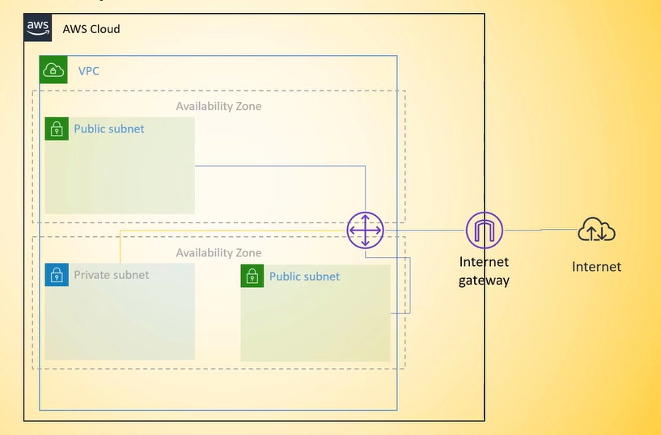

# AWS Infrastructure as Code

A learning project that provisions the same AWS network infrastructure two ways: using the **AWS CLI** with bash scripts and using **Terraform**. The goal is to understand how both tools work, what commands they map to, and how to manage infrastructure lifecycle (create and delete) with each.

## Architecture

The project builds the following network layout in `us-east-1`:



### Network resources

| Resource | Name | CIDR / Detail | AZ |
|---|---|---|---|
| VPC | my-codeCreatedVPC | 10.0.0.0/16 | — |
| Public Subnet 1 | Public_Subnet_1 | 10.0.1.0/24, auto-assign public IPv4 | us-east-1a |
| Private Subnet | Private_Subnet_1 | 10.0.10.0/24 | us-east-1a |
| Public Subnet 2 | Public_Subnet_2 | 10.0.2.0/24, auto-assign public IPv4 | us-east-1b |
| Internet Gateway | my-codeCreatedIGW | — | — |
| Elastic IP | my-codeCreatedNATGW-EIP | Attached to NAT Gateway | — |
| NAT Gateway | my-codeCreatedNATGW | Placed in Public_Subnet_1 | us-east-1a |
| Public Route Table | Public_Route_Table | 0.0.0.0/0 → IGW | — |
| Private Route Table | Private_Route_Table | 0.0.0.0/0 → NAT GW | — |

### Compute resources

| Resource | Name | Subnet | Type | Public IP |
|---|---|---|---|---|
| Security Group | ec2_HeartBeat | VPC-wide | — | SSH (22) + HTTP (80) open |
| Bastion Host | Bastion_Host | Public_Subnet_1 | t2.micro | Yes (auto-assign from subnet) |
| Private Instance 1 | Private_HeartBeat_1 | Private_Subnet_1 | t2.micro | Yes (explicitly assigned at launch) |
| Private Instance 2 | Private_HeartBeat_2 | Private_Subnet_1 | t2.micro | Yes (explicitly assigned at launch) |

**Public subnets** are associated with the public route table (`0.0.0.0/0 → IGW`) and have auto-assign public IPv4 enabled, so instances launched there are directly reachable from the internet.

**Private_Subnet_1** is associated with the private route table (`0.0.0.0/0 → NAT Gateway`). Instances there can initiate outbound connections to the internet through the NAT Gateway but are not directly reachable from outside the VPC — except the two private instances which have a public IP explicitly assigned at launch time so the bastion pattern works.

All three instances run the **Heartbeat Automation** app (Amazon Linux 2023, user-data script). Shutdown behaviour is set to **terminate** so stopping an instance from inside the OS cleans it up rather than leaving a stopped instance running up charges.

## Project structure

```
AWS_CLI/
  Create.sh       # Creates all resources and saves their IDs to Resources.env
  Delete.sh       # Reads Resources.env and deletes everything in the correct order
  Resources.env   # Auto-generated file that stores resource IDs between runs

Terraform/
  main.tf         # VPC, subnets, IGW, EIP, NAT GW, route tables, SG, instances
  variables.tf    # Region, VPC CIDR, VPC name, instance type, key pair name
  outputs.tf      # All resource IDs, public/private IPs

Docs/
  01-INSTALL-TERRAFORM-AWSCLI.md      # How to install Terraform and AWS CLI
  02-AWS-CREDENTIALS-CODESPACES.md    # How to configure AWS credentials in Codespaces
  03-TERRAFORM-WORKFLOW.md            # Full command reference and workflow for both tools
  04-NETWORK-CONCEPTS-EXPLAINED.md    # Beginner's guide to every concept used in this project
```

## Prerequisites

- A GitHub Codespace (or any Linux environment)
- An AWS account with an IAM user or role that has permissions to manage VPCs and EC2 instances
- Terraform >= 1.3.0
- AWS CLI v2

If you need to install Terraform and the AWS CLI, follow [Docs/01-INSTALL-TERRAFORM-AWSCLI.md](Docs/01-INSTALL-TERRAFORM-AWSCLI.md).

## AWS credentials setup

AWS credentials must never be committed to the repository. This project reads them from environment variables (`AWS_ACCESS_KEY_ID`, `AWS_SECRET_ACCESS_KEY`, `AWS_DEFAULT_REGION`), which you configure as GitHub Codespaces secrets.

Full setup instructions: [Docs/02-AWS-CREDENTIALS-CODESPACES.md](Docs/02-AWS-CREDENTIALS-CODESPACES.md)

Once configured, verify authentication before running anything:

```bash
aws sts get-caller-identity
```

## Option 1 — AWS CLI

The bash scripts in `AWS_CLI/` call the AWS API directly and track resource IDs in `Resources.env` so they can be deleted later.

### Create

```bash
bash AWS_CLI/Create.sh
```

The script will:
1. Create the VPC
2. Create all three subnets; enable auto-assign public IPv4 on both public subnets
3. Create the Internet Gateway and attach it to the VPC
4. Create the public route table with a `0.0.0.0/0` → IGW route and associate both public subnets
5. Allocate an Elastic IP address
6. Create the NAT Gateway in Public_Subnet_1 using the Elastic IP and wait for it to become available
7. Create the private route table with a `0.0.0.0/0` → NAT Gateway route and associate Private_Subnet_1
8. Resolve the latest Amazon Linux 2023 AMI ID for the region
9. Create the `ec2_HeartBeat` security group with SSH (22) and HTTP (80) inbound rules
10. Launch the `Bastion_Host` instance in Public_Subnet_1
11. Launch `Private_HeartBeat_1` and `Private_HeartBeat_2` in Private_Subnet_1 with explicit public IP assignment
12. Save all resource IDs to `AWS_CLI/Resources.env`

### Delete

```bash
bash AWS_CLI/Delete.sh
```

The script reads `Resources.env`, prints a summary of what will be deleted, and asks you to type `DELETE` to confirm. It then removes everything in reverse dependency order:

1. Terminate all three EC2 instances and wait for them to reach the terminated state
2. Disassociate and delete the private route table
3. Delete the NAT Gateway and wait for it to terminate
4. Release the Elastic IP
5. Disassociate and delete the public route table
6. Detach and delete the Internet Gateway
7. Delete the security group
8. Delete the subnets
9. Delete the VPC

For the full AWS CLI command reference and workflow, see [Docs/03-TERRAFORM-WORKFLOW.md](Docs/03-TERRAFORM-WORKFLOW.md).

## Option 2 — Terraform

Terraform manages all the same resources through its state file and resolves dependency and deletion order automatically.

### Create

```bash
cd Terraform
terraform init
terraform fmt -check
terraform validate
terraform plan -out=tfplan
terraform show tfplan       # review before applying
terraform apply tfplan
terraform output            # see all resource IDs and IP addresses
```

### Delete

```bash
cd Terraform
terraform plan -destroy     # review what will be removed
terraform destroy
```

For the full command reference and workflow for both tools, see [Docs/03-TERRAFORM-WORKFLOW.md](Docs/03-TERRAFORM-WORKFLOW.md).

### Importing existing CLI resources into Terraform

If you already ran `Create.sh` and want to manage those resources with Terraform instead, do not run `terraform apply` against an empty state — it will create duplicates. Import the existing resources first:

```bash
cd Terraform
terraform init
terraform import aws_vpc.main                                         <VPC_ID>
terraform import 'aws_subnet.subnets["Public_Subnet_1"]'             <SUBNET_Public_Subnet_1_ID>
terraform import 'aws_subnet.subnets["Private_Subnet_1"]'            <SUBNET_Private_Subnet_1_ID>
terraform import 'aws_subnet.subnets["Public_Subnet_2"]'             <SUBNET_Public_Subnet_2_ID>
terraform import aws_internet_gateway.main                            <IGW_ID>
terraform import aws_eip.nat                                          <EIP_ALLOC_ID>
terraform import aws_nat_gateway.main                                 <NATGW_ID>
terraform import aws_route_table.public                               <RTB_ID>
terraform import aws_route_table.private                              <PRIVATE_RTB_ID>
terraform import aws_security_group.ec2_heartbeat                    <SG_ID>
terraform import aws_instance.bastion                                 <BASTION_ID>
terraform import 'aws_instance.private[0]'                           <PRIVATE_INSTANCE_1_ID>
terraform import 'aws_instance.private[1]'                           <PRIVATE_INSTANCE_2_ID>
terraform plan  # should show no changes if the config matches reality
```

Resource IDs can be found in `AWS_CLI/Resources.env`.

## Key concepts

**What is a bastion host?**
A bastion host (also called a jump server) is a single, hardened instance placed in a public subnet that acts as the only entry point into your private network. Instead of opening SSH access directly to every private instance, you SSH into the bastion first, then SSH from the bastion to the private instance. This means only one machine needs to face the internet, and you only have one place to audit and control access.

**Why do the private instances have a public IP if the subnet is private?**
The subnet is private in the routing sense — its default route goes through the NAT Gateway, not the Internet Gateway, so inbound connections from the internet cannot reach these instances on their own. The public IP is assigned explicitly at launch so the bastion pattern and app access work as intended. This is a deliberate trade-off for this learning project.

**Why do public subnets have auto-assign public IPv4 enabled?**
Without this setting, instances launched into a public subnet only get a private IP. Auto-assign public IPv4 means every new instance automatically receives a public IP, making it reachable from the internet (subject to security groups) without any extra configuration at launch time.

**Why does the private subnet route through the NAT Gateway instead of the IGW?**
The NAT Gateway lets instances in the private subnet initiate outbound connections (e.g. the user-data script cloning a git repo and running `dnf update`) without exposing them to inbound connections from the internet. Traffic goes: private instance → NAT GW → IGW → internet. The private instance is never directly addressable from outside.

**Why is the shutdown behaviour set to terminate?**
By default, shutting down an EC2 instance from inside the OS (e.g. `sudo shutdown now`) only **stops** it — the instance and its EBS volume keep running up charges. Setting shutdown behaviour to **terminate** means the instance is permanently deleted when the OS shuts down, which is the correct behaviour for disposable, script-provisioned instances.

**Why does deletion order matter in the CLI scripts?**
AWS enforces resource dependencies. You cannot delete a subnet while an instance is still running in it, cannot delete a security group while instances still reference it, and cannot release an Elastic IP while it is still attached to a NAT Gateway. The scripts remove dependencies in reverse creation order before deleting parent resources.

**NAT Gateway cost warning**
NAT Gateways are billed by the hour (~$0.045/hr) plus per-GB data transfer, even when idle. EC2 instances also accrue charges while running. Remember to run `Delete.sh` or `terraform destroy` when you are done experimenting.
