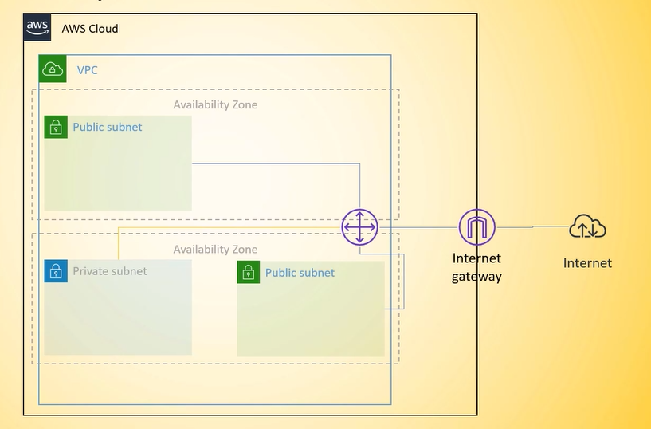

# AWS Infrastructure as Code

A learning project that provisions the same AWS network infrastructure two ways: using the **AWS CLI** with bash scripts and using **Terraform**. The goal is to understand how both tools work, what commands they map to, and how to manage infrastructure lifecycle (create and delete) with each.

## Architecture

The project builds the following network layout in `us-east-1`:



| Resource | Name | CIDR | AZ |
|---|---|---|---|
| VPC | my-codeCreatedVPC | 10.0.0.0/16 | — |
| Public Subnet 1 | Public_Subnet_1 | 10.0.1.0/24 | us-east-1a |
| Private Subnet | Private_Subnet_1 | 10.0.10.0/24 | us-east-1a |
| Public Subnet 2 | Public_Subnet_2 | 10.0.2.0/24 | us-east-1b |
| Internet Gateway | my-codeCreatedIGW | — | — |
| Route Table | Public_Route_Table | 0.0.0.0/0 → IGW | — |

The two public subnets are associated with a route table that sends all outbound traffic (`0.0.0.0/0`) to the Internet Gateway. The private subnet is left on the VPC's default main route table, which has no internet route.

## Project structure

```
AWS_CLI/
  Create.sh       # Creates all resources and saves their IDs to Resources.env
  Delete.sh       # Reads Resources.env and deletes everything in the correct order
  Resources.env   # Auto-generated file that stores resource IDs between runs

Terraform/
  main.tf         # VPC, subnets, internet gateway, route table, associations
  variables.tf    # Region, VPC CIDR, VPC name
  outputs.tf      # VPC ID, subnet IDs, IGW ID, route table ID

Docs/
  01-INSTALL-TERRAFORM-AWSCLI.md      # How to install Terraform and AWS CLI
  02-AWS-CREDENTIALS-CODESPACES.md    # How to configure AWS credentials in Codespaces
  03-TERRAFORM-WORKFLOW.md            # Full command reference and workflow for the AWS CLI scripts and Terraform
```

## Prerequisites

- A GitHub Codespace (or any Linux environment)
- An AWS account with an IAM user or role that has permissions to manage VPCs
- Terraform >= 1.3.0
- AWS CLI v2

If you need to install Terraform and the AWS CLI, follow [Docs/01-INSTALL-TERRAFORM-AWSCLI.md](Docs/01-INSTALL-TERRAFORM-AWSCLI.md).

## AWS credentials setup

AWS credentials must never be committed to the repository. This project reads them from environment variables (`AWS_ACCESS_KEY_ID`, `AWS_SECRET_ACCESS_KEY`, `AWS_DEFAULT_REGION`), which you configure as GitHub Codespaces secrets.

Full setup instructions: [Docs/02-AWS-CREDENTIALS-CODESPACES.md](Docs/02-AWS-CREDENTIALS-CODESPACES.md)

Once configured, verify authentication before running anything:

```bash
aws sts get-caller-identity
```

## Option 1 — AWS CLI

The bash scripts in `AWS_CLI/` call the AWS API directly and track resource IDs in `Resources.env` so they can be deleted later.

### Create

```bash
bash AWS_CLI/Create.sh
```

The script will:
1. Create the VPC
2. Create all three subnets
3. Create the Internet Gateway and attach it to the VPC
4. Create the public route table with a `0.0.0.0/0` → IGW route
5. Associate both public subnets with the route table
6. Save all resource IDs to `AWS_CLI/Resources.env`

### Delete

```bash
bash AWS_CLI/Delete.sh
```

The script reads `Resources.env`, prints a summary of what will be deleted, and asks you to type `DELETE` to confirm. It then removes everything in the correct dependency order:

1. Disassociate route table from subnets
2. Delete the route table
3. Detach and delete the Internet Gateway
4. Delete the subnets
5. Delete the VPC

For the full AWS CLI command reference and workflow, see [Docs/03-TERRAFORM-WORKFLOW.md](Docs/03-TERRAFORM-WORKFLOW.md).

## Option 2 — Terraform

Terraform manages all the same resources through its state file and resolves dependency and deletion order automatically.

### Create

```bash
cd Terraform
terraform init
terraform fmt -check
terraform validate
terraform plan -out=tfplan
terraform show tfplan       # review before applying
terraform apply tfplan
terraform output            # see the created resource IDs
```

### Delete

```bash
cd Terraform
terraform plan -destroy     # review what will be removed
terraform destroy
```

For the full command reference and workflow for both tools, see [Docs/03-TERRAFORM-WORKFLOW.md](Docs/03-TERRAFORM-WORKFLOW.md).

### Importing existing CLI resources into Terraform

If you already ran `Create.sh` and want to manage those resources with Terraform instead, do not run `terraform apply` against an empty state — it will create duplicates. Import the existing resources first:

```bash
cd Terraform
terraform init
terraform import aws_vpc.main <VPC_ID>
terraform import 'aws_subnet.subnets["Public_Subnet_1"]'  <PUBLIC_SUBNET_1_ID>
terraform import 'aws_subnet.subnets["Private_Subnet_1"]' <PRIVATE_SUBNET_1_ID>
terraform import 'aws_subnet.subnets["Public_Subnet_2"]'  <PUBLIC_SUBNET_2_ID>
terraform import aws_internet_gateway.main                <IGW_ID>
terraform import aws_route_table.public                   <RTB_ID>
terraform plan  # should show no changes if the config matches reality
```

Resource IDs can be found in `AWS_CLI/Resources.env`.

## Key concepts

**Why does `0.0.0.0/0` point at the IGW and not the VPC?**
The route target must be the Internet Gateway — that is the component that bridges the VPC to the internet. The VPC itself is just the network container. A subnet only becomes truly public when it is associated with a route table that has a `0.0.0.0/0` → IGW route.

**Why is the private subnet not associated with the public route table?**
Keeping the private subnet on the VPC's default main route table (which only has the local VPC route) means it has no path to the internet, which is the definition of a private subnet.

**Why does deletion order matter in the CLI scripts?**
AWS enforces resource dependencies. You cannot delete a VPC that still has an attached Internet Gateway, and you cannot delete a route table that still has subnet associations. The scripts remove dependencies in reverse order before deleting the parent resources.
